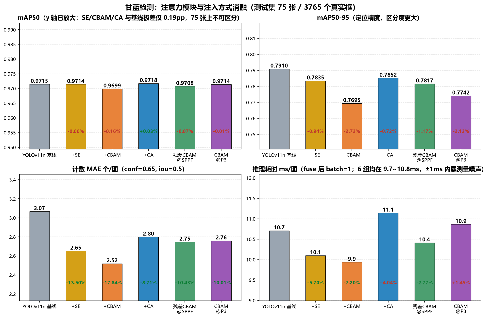
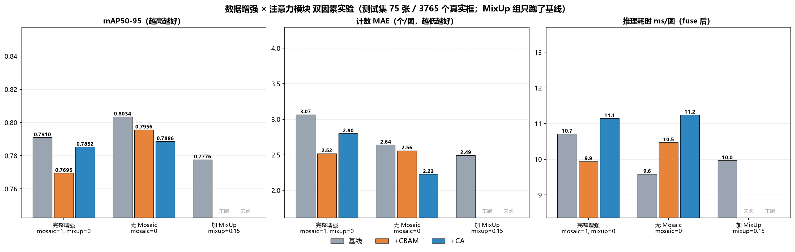
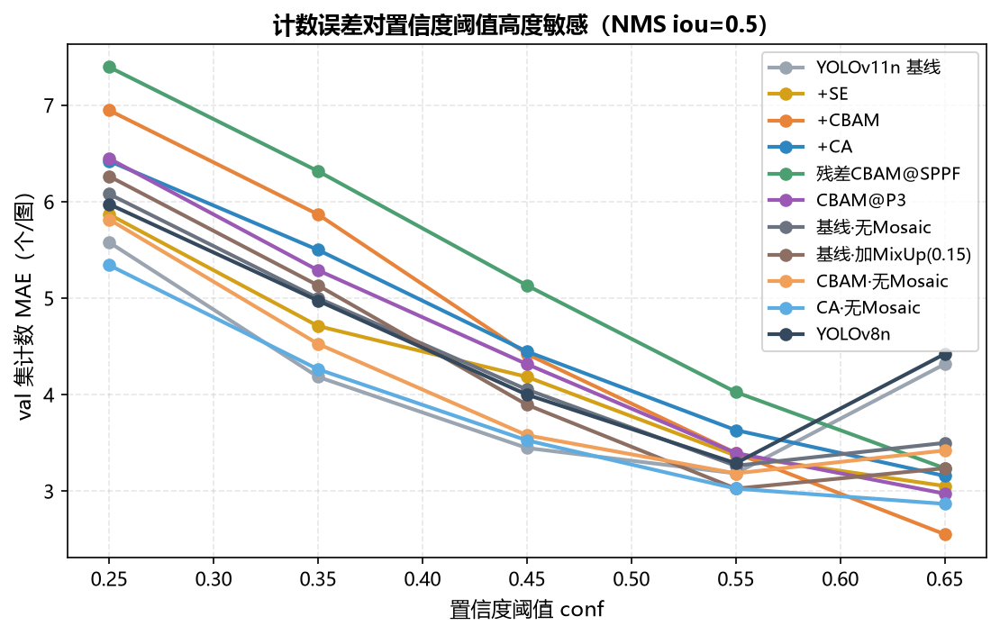
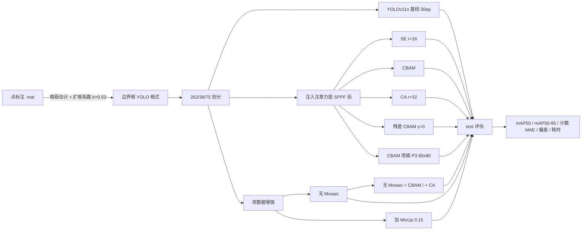

# Cabbage-Det：无人机航拍甘蓝检测与消融复现

用 YOLOv11n 在无人机航拍图上做**密集小目标**甘蓝（cabbage）检测与计数。
复现原论文的注意力消融 / 增强消融 / 交叉实验，并额外回答一个原论文没问的问题：
**这些差异到底是不是噪声 —— 多大的差异才值得相信。**



## 结论先说（TL;DR）

- **三种注意力模块都没有检测增益**：SE / CBAM / CA 插在 SPPF 后，再加两种注入形式变体，
  六组与基线的 **mAP50 极差只有 0.19pp**（0.9699~0.9718），**mAP50-95 的点估计一致略降**。
  补齐三个种子后，与基线的配对差是 **SE −0.36 / CBAM −0.77 / CA −0.19pp**，
  而它们各自的 MDD 是 1.29 / 1.67 / 0.51pp —— **全部不可区分**。
  原论文「用 mAP50 排序把 CBAM 选成最优模型」这件事，在可复核的 test 协议下**复现不出来**。
- **误差棒的正确算法，比结果本身更值得讲**：这个项目有**两个独立**的噪声源，而且
  **一个也不是常数**。评估端单模型 bootstrap CI 半宽 ±2.66pp，但它**不能**用来比较两个模型 ——
  两个模型跑的是同一批图，图难度的公共成分会同时影响两者、在比较时应当抵消。改成**配对
  bootstrap** 后 Δ 的 CI 半宽缩到 **±0.57pp**（收窄 4.7 倍）。训练端 σ 按配置不同，
  **11 组 × 3 种子全部实测**，范围 **0.10 ~ 1.16pp**：YOLOv8n 只有 0.10、基线 0.23、CA 0.28、
  无 Mosaic 0.68、SE 0.89、CBAM@P3 1.00、**CBAM 1.16（基线的 5 倍）**。
  → 把两者合成并按各配置自己的门槛 + Bonferroni 校正判，10 个对比里**只有 2 个站得住**：
  **YOLOv8n −2.30pp（余量 4.3 倍）** 与 **加 MixUp −1.06pp（余量 1.5 倍）**。
  同时 mAP50 的标准差只有 **0.01pp** —— 它在这批数据上是常数，不是"肉眼看差不多"。
- **同一个对比，换一种问法，答案可以不一样**：seed 0 那次训练里「无 Mosaic」比完整增强高
  **1.25pp**，配对 CI [+0.62, +1.76] 不含 0 —— 问「这两个权重谁更好」，有明确答案。
  但换两个种子重训，优势缩到 **0.59pp** —— 问「这个方法更好吗」，没有答案。
  **CBAM 是更极端的例子**：单次 −2.15pp 看着像"确定有害"，三种子平均只有 −0.77pp，
  逐 seed 是 −2.15 / −0.09 / −0.06。**无Mosaic+CA 甚至翻转了方向**（−0.24 → +0.75pp）。
  两个答案都对，它们回答的不是同一个问题。
- **管线本身完全可复现**：同 seed 重跑 50 轮，mAP 与 loss **逐位相同**（差 `+0.00e+00`），
  因此上面测到的波动是纯种子效应，不含算子非确定性。
- **原论文的「无 MixUp」对照是空实验**：ultralytics 的 `mixup` 默认就是 0.0，dump 全部历史
  run 的 `args.yaml` 后发现**每一个都是 0.0**，所以"移除 MixUp"与"完整增强"是同一份配置。
  本工作改成「主动加入 mixup=0.15 vs 不加」，才构成真正的对照 —— 三种子实测 **−1.06pp**
  （逐 seed −1.33 / −0.84 / −1.01），是全部对比里**唯一能确定方向为负的训练策略改动**。
- **真实收益在"数株数"，而且机制不是"数得更准"**：计数 MAE 从 3.07 降到 2.23~2.80
  （−8.8%~−27.4%），但拆开看，改善几乎全部来自**系统性偏差被消除**（bias −2.27 → ≈0），
  即模型"不再稳定漏检 2 个"，代价是轻微过检。
- **推理开销在部署形态下不存在**：同批次 fuse 后十组在 9.6~11.2ms；未 fuse 时才有 +12%~16%。
  早期"慢 15~27%"的结论是测速时后台还在训练的伪影。
  更进一步：**笔记本上绝对时延不可复现**——同一个 `base_v2` 三次测量得到 7.84 / 12.04 / 10.71ms
  （差 35%），因此"谁比谁快几毫秒"不构成结论，只能看同一次测量内的相对关系。
- **踩到一个隐蔽的坑**：ultralytics 的 `model.train()` 在 `self.ckpt` 为空时会**静默丢弃**
  手工加载的预训练权重，把模型重建为随机初始化。不加断言的话，会得出完全错误的实验结论。
- **复现范围**：原论文四组（A 模型对比 / B 增强消融 / C 注意力消融 / D 交叉实验）全部覆盖，
  另加 E 注入形式、F 噪声预算两组原论文没有的实验，共 **37 个训练 run（11 组配置 × 3 种子全实测）**。
  RT-DETR 一行是跨环境 20ep，只作存在性证明、不参与排名 →
  [REPRO_STATUS.md](REPRO_STATUS.md)（覆盖矩阵与判据）
  · [EXPERIMENT_CBAM.md](EXPERIMENT_CBAM.md)（完整实验记录与踩坑过程）

## 结果（测试集 75 张 / 3765 个真实框）

**注意力模块消融（复现原论文 C 组）**

| 模型 | mAP50 | mAP50-95 | P | R | 计数 MAE(个/图) | 计数 MAPE | 偏差 | 推理 ms/图 | 参数量 |
|---|---|---|---|---|---|---|---|---|---|
| YOLOv11n 基线 | 0.9715 | **0.7910** | 0.9738 | 0.9472 | 3.07 | 5.90% | −2.27 | 10.7 | 2.6049M |
| + SE | 0.9714 | 0.7835 | 0.9668 | 0.9516 | 2.65 | 5.29% | +0.07 | 10.1 | 2.6133M |
| + CBAM | 0.9699 | 0.7695 | 0.9684 | 0.9511 | **2.52** | **5.10%** | +0.47 | 9.9 | 2.6132M |
| + CA | **0.9718** | 0.7852 | 0.9721 | 0.9515 | 2.80 | 5.70% | +1.07 | 11.1 | 2.6110M |

> 上表是 seed 0 单次。**三种子均值（mAP50-95）**：SE **0.7866 ± 0.0089**、
> CBAM **0.7826 ± 0.0116**、CA **0.7883 ± 0.0028**，基线 **0.7903 ± 0.0023**。
> CBAM 的 0.7695 是它三个种子里最差的一次（另两次 0.7868 / 0.7915），
> 这也是"单次训练不能排序"最直接的证据。

**注入形式扩展（原论文没有，本工作新增）**

| 模型 | mAP50 | mAP50-95 | 计数 MAE | 偏差 | 推理 ms/图 |
|---|---|---|---|---|---|
| 残差CBAM@SPPF | 0.9708 | 0.7817 | 2.75 | +1.23 | 10.4 |
| CBAM@P3 | 0.9714 | 0.7742 | 2.76 | +0.04 | 10.9 |

**数据增强消融（复现原论文 B 组，基线架构）**

| 配置 | mAP50 | mAP50-95 | 计数 MAE | 偏差 | 推理 ms/图 |
|---|---|---|---|---|---|
| 完整增强（mosaic=1） | 0.9715 | 0.7910 | 3.07 | −2.27 | 10.7 |
| **无 Mosaic**（mosaic=0） | 0.9716 | **0.8034** | 2.64 | −1.12 | 9.6 |
| **加 MixUp 0.15** | 0.9712 | 0.7776 | **2.49** | −0.81 | 10.0 |

> 三种子均值：完整 **0.7903 ± 0.0023**、无 Mosaic **0.7962 ± 0.0068**、加 MixUp **0.7797 ± 0.0022**。
> 配对差 **+0.59 / −1.06pp** —— 只有 **MixUp 能确定是负的**（σ 仅 0.25pp），
> 无 Mosaic 的 +0.59pp 低于 MDD 1.01pp，0.8034 是它抽到的好签。

**交叉实验：增强 × 注意力（复现原论文 D 组，表中为 mAP50-95）**

| 增强档位 | 无注意力 | +CBAM | +CA |
|---|---|---|---|
| 完整增强 | **0.7910** | 0.7695 | 0.7852 |
| 无 Mosaic | **0.8034** | 0.7956 | 0.7886 |

> 同样是 seed 0 单次。补齐种子后（三种子配对 Δ）：无注意力 +0.59 / +0.74 / +0.75pp，
> 注意力类 −0.19 ~ −0.77pp —— **全部不可区分**。
> 其中最"像结论"的是「无Mosaic+CBAM」+0.74pp（σ 仅 0.25pp，95% CI [+0.10, +1.39] 不含 0），
> 但 10 重比较校正后是 [−0.18, +1.67]。**这张 2×3 表里没有任何一格可以当结论用。**

**模型对比（复现原论文 A 组）**

| 模型 | 参数量 | epochs | mAP50 | mAP50-95 | 计数 MAE | 偏差 | 推理 ms/图 |
|---|---|---|---|---|---|---|---|
| YOLOv11n | 2.605M | 50 | **0.9715** | **0.7910** | **3.07** | −2.27 | 10.7 |
| YOLOv8n | 3.138M | 50 | 0.9710 | 0.7662 | 3.32 | −2.71 | 7.5 |
| RT-DETR-L ※ | 31.99M | 20 | 0.9689 | 0.7444 | — | — | — |

> **YOLOv8n 是全部 10 个对比里最硬的一条结论**：三种子 mAP50-95 = 0.7672 ± 0.0010
> （σ 只有 0.10pp，是 11 组里最小），配对差 **−2.30pp**，合成 Bonferroni CI
> [−3.31, −1.30]。σ 要涨到 4.3 倍才会翻转。
> 但它**更小更快**（7.5ms vs 10.7ms），所以"哪个更好"仍取决于场景 —— 精度上输得明确，
> 部署上可能赢。
>
> ※ RT-DETR 是**跨环境 + 跨协议**的一行，不可与上面两行直接比较：权重由原项目在
> ultralytics 8.4.37 + GTX 1650 上训练 20 epoch（YOLO 是 50 epoch），且 DETR 必须用
> AdamW 小学习率、8G 显存下 batch 只能到 4。它的价值在于**证明原实验确实做过**
> （test mAP50 96.89 与论文 val 94.4 量级吻合），而不是参与排名。
>
> 计数阈值 conf=0.65 / NMS iou=0.5 在 **val** 上选定，test 只做报告；
> 推理耗时为 RTX 5060 Laptop 8GB、batch=1、640×640、fuse 后 100 次平均（11 组同批次测）。

两张图分别是「注意力 6 组四联对比」与「增强 × 注意力双因素三面板」：

| 注意力消融 | 增强 × 注意力 |
|---|---|
|  |  |

计数指标本身也是被验证过的对象——阈值敏感性曲线见
。

## 为什么值得看这个仓库

### 1. 数据集与标注不是标准流程

数据是自采的大疆 M3M 正射影像（1024×1024，湖北嘉鱼），标注是**点**而不是框。
用「相邻点间距的 10% 分位数估株距 × 扩框系数 k=0.53」把点自适应扩成边界框，
再按 7:1:2 划分（262/38/75 张，18,811 个框，单图 31~89 个目标）。
市面上的甘蓝数据集没有这个问题，所以这套转换逻辑是这个项目最不可替代的部分。

### 2. 评估体系是重做的，不是只报 mAP50

在这个数据集上 **mAP50 会饱和**：加 SE、CBAM、CA 三组实测锁在 96.99~97.18%，
原论文里开不开 Mosaic、换三种模型也都是 96~97%。这不是模型好，而是「IoU>0.5 即算对」
在单类易识别目标上失去了区分度。

于是补了三层评估：

| 层 | 指标 | 回答什么问题 |
|---|---|---|
| 定位精度 | mAP50-95 | 框画得准不准 |
| 计数精度 | MAE / RMSE / MAPE / 偏差 / 完全数对率 | 数株数错几个（农业真正关心的） |
| 分密度 | sparse / medium / dense 三档 MAE | 模型在哪一档掉链子 |

### 3. 计数指标本身也被验证过

第一版用固定 conf=0.25 / iou=0.7 数框，发现换一批同样配置重训，结论就反过来了。
排查后确认：密集场景下相邻植株框的 IoU 大量落在 0.5~0.7，iou=0.7 的 NMS 抑制不掉近重复框，
**MAE 实际由阈值决定，而不是模型决定**。

于是写了 `tools/count_sweep.py`：单次前向保存全部候选框，事后对 (conf, iou) 网格扫描，
**在 val 上选阈值、在 test 上报告**。扫描曲线显示排名在 conf≈0.55 处翻转。

### 4. 每个结论都配一个误差棒 —— 而且这个误差棒被审过三次

项目里分三层回答「这个差异是真的吗」：

| 层 | 做法 | 得到什么 |
|---|---|---|
| 可复现性 | 同 seed 重跑 50 轮 | 指标逐位一致，排除算子非确定性 |
| 训练随机性 | **11 组 × 3 seed** 重训（33 run） | σ = 0.10 ~ 1.16pp（**不是常数，差 11 倍**） |
| 评估抽样 | 75 图 × 1000 次**配对** bootstrap | Δ 的 CI 半宽 ±0.57pp |

**第一次审**：第一版用的是**非配对** bootstrap，得出「mAP50-95 分辨不了 2.7pp」。
这个推导有个错误：两个模型跑的是同一批图，图难度的公共成分会同时压低两者，
在比较差异时**应当抵消**，而不是叠进误差棒。改用配对重采样后门槛从 ±2.66pp 收窄到 ±0.57pp。
当时据此判出「CBAM 显著有害 −2.15pp」。

**第二次审**：问题是训练端 σ 只有基线两个档位实测（0.23 / 0.68pp），其余配置全部借用这个值 ——
这相当于假设"给模型加注意力分支不会增加训练随机性"。给 SE / CBAM / CA 各补两个种子后，
实测 σ 是 0.89 / **1.16** / 0.28pp：**CBAM 的随机波动是基线的 5 倍**，
它的三种子配对效应只有 −0.77pp。那条"显著有害"的结论因此被撤回。

**第三次审**：还剩 6 个配置在借用 σ，而**唯一过线的 YOLOv8n 恰好就在借用名单里**，
借用值 0.74pp 把它的余量压到 1.1 倍。把剩下 6 个配置也各补 2 个种子（12 个新 run）后，
实测 YOLOv8n 的配对 σ 只有 **0.31pp** —— 借用值高估了 2.4 倍，余量其实是 **4.3 倍**。
同时 MixUp 从"方向待测"变成确定的 **−1.06pp**。**结论是：借用的 σ 不只影响显著性，
还会让本来很硬的结论看起来摇摇欲坠。**


上排 = seed 0 单次 Δ（配对 bootstrap），下排 = 效应量（三种子均值）± 合成 CI。
★ = 能扛住多重比较校正的。**10 个对比里只有 2 个站得住**（YOLOv8n、MixUp），
其余全部落回不可区分区。

## 方法



注意力注入的实现要点（`tools/train_cbam_fixed.py`）：

1. 读官方 `yolo11.yaml`，在目标层后插入一层，**把所有 ≥ 插入点的绝对索引 +1**
   （YOLO 每层都有 `f` 来源索引，直接 `Sequential` 拼层会错位）；
2. 自定义模块**不会被 `parse_model` 自动缩放通道**，yaml 里必须写缩放后的实际通道
   （yolo11n 的 SPPF 输出是 1024×0.25=256，不是 1024）；
3. 插在 skip-connection 源头（如 P3）时，后续引用该层的层必须**改指向注意力层**，
   否则 Detect 仍取用未经过注意力的原始特征；
4. 预训练权重按索引**重映射**加载（插入点之后的层号 +1），并断言训练器真的保留了它。

## 快速开始

```bash
# 环境（Windows + CUDA 12.8 示例）
python -m venv .venv
.venv/Scripts/pip install torch torchvision --index-url https://download.pytorch.org/whl/cu128
.venv/Scripts/pip install ultralytics -i https://mirrors.aliyun.com/pypi/simple/

# 训练基线
python tools/train_baseline.py --epochs 50 --batch 8 --device 0 --workers 0 --name train_base_v2

# 训练三种注意力模块（复现原论文消融）
python tools/train_cbam_fixed.py --variant se --epochs 50 --batch 8 --device 0 --workers 0 --name train_se
python tools/train_cbam_fixed.py --epochs 50 --batch 8 --device 0 --workers 0 --name train_cbam_v2
python tools/train_cbam_fixed.py --variant ca --epochs 50 --batch 8 --device 0 --workers 0 --name train_ca

# 注入形式扩展（原论文没有）
python tools/train_cbam_fixed.py --variant residual --epochs 50 --batch 8 --device 0 --workers 0 --name train_cbam_res_v2
python tools/train_cbam_fixed.py --insert-index 16 --epochs 50 --batch 8 --device 0 --workers 0 --name train_cbam_p3

# 数据增强消融 + 交叉实验（复现原论文 B / D 组）
python tools/train_baseline.py    --mosaic 0.0 --epochs 50 --batch 8 --device 0 --workers 0 --name train_base_nomosaic
python tools/train_baseline.py    --mixup 0.15 --epochs 50 --batch 8 --device 0 --workers 0 --name train_base_mixup
python tools/train_cbam_fixed.py  --mosaic 0.0 --epochs 50 --batch 8 --device 0 --workers 0 --name train_cbam_nomosaic
python tools/train_cbam_fixed.py  --variant ca --mosaic 0.0 --epochs 50 --batch 8 --device 0 --workers 0 --name train_ca_nomosaic

# 评估 + 阈值扫描 + 测速 + 出图
python tools/eval_full.py --weights runs/detect/train_se/weights/best.pt --split test --name se
python tools/count_sweep.py --models base_v2:... se:... cbam_v2:... ca:...   # 一次给全 11 组，否则阈值不统一
python tools/bench_speed.py --models base_v2:... se:... cbam_v2:... ca:...   # 测速要独占 GPU
python tools/make_report.py
```

单次 50 epoch 训练：RTX 5060 约 8~13 分钟，GTX 1650 约 1.5~2 小时。

> `--workers 0` 是有意为之：16G 内存机器上 `workers>=4` 会因数据加载进程 OOM。

## 目录结构

```
├── tools/
│   ├── cbam_module.py         CBAM / CBAMResidual（+ 注册进 ultralytics 命名空间）
│   ├── attention_modules.py   SE / CoordAtt（8.4.194 已移除，按原实现重写）
│   ├── train_cbam_fixed.py    注入 yaml 生成 / 预训练重映射 / 权重一致性断言 / 训练
│   ├── train_baseline.py      同环境基线
│   ├── eval_full.py           检测 + 计数 + 分密度评估
│   ├── count_sweep.py         (conf, iou) 扫描，val 选参 test 报告
│   ├── bench_speed.py         参数量与 fused 耗时
│   ├── make_report.py         汇总表与图
│   ├── bootstrap_ci.py        单模型 bootstrap（非配对，不能当比较门槛）
│   ├── paired_bootstrap.py    配对 bootstrap：Δ 的 CI + Bonferroni
│   ├── seed_variance.py       种子方差、配对 Δ、MDD
│   ├── noise_budget.py        评估端 + 训练端噪声合成，输出最终判定
│   ├── experiment_registry.py 11 组配置 ↔ 33 个 run 的唯一映射来源
│   ├── check_pairing.py       校验种子 run 与原 run 只差 seed（114 字段 + 结构签名）
│   ├── train_seeds.sh         可重入的种子训练驱动（跳过已完成、崩溃重试一次）
│   ├── eval_seeds.sh          可重入的种子评估驱动
│   └── probe_pretrained.py    诊断：训练前 mAP 是否等于基线
├── eval_reports/              11 组模型 json/md、五张对比表、噪声预算与种子方差图
├── data.yaml                  数据集索引
├── flask_detect.py            网页端批量检测 + CSV 导出（毕设系统）
├── REPRO_STATUS.md            原论文实验矩阵 vs 本次复现覆盖情况
└── EXPERIMENT_CBAM.md         完整实验记录与踩坑过程
```

## 局限与后续

- **训练端噪声已全部实测**：11 组配置 × 3 个种子 = 33 个 run，σ 从 0.10（YOLOv8n）到
  1.16pp（CBAM），**没有任何借用值**。早期版本曾用「6 个架构不同的模型极差 2.15pp」
  当噪声参照，**这个参照是错的** —— 架构差异本身就是信号、不是噪声，
  拿它当噪声会把门槛系统性高估，进而把真实效应掩盖掉；
- **A 组只差 RT-DETR**：它不能塞进同一张表——原论文只跑 20 epoch、必须用 AdamW 小学习率、
  8G 显存下 batch 只能到 4，与 YOLO 的 50ep/SGD/batch8 三项都不同。需要单独设计协议，
  见 [REPRO_STATUS.md](REPRO_STATUS.md) 第 7 节；
- **50 epoch 偏少**：注意力层是随机初始化的；观测到 residual 版的 γ 只学到 ±0.003，接近自我关闭。
  这也是注意力组 σ 偏大的可能原因之一；
- **n=3 的 σ 本身不可靠**：σ 的 90% CI 约为 [0.58s, 4.4s]，所以判定只到量级，不报 p 值；
- **测速只到 PyTorch**：ONNX / TensorRT 未测，fuse 后的结论不能直接外推到量化引擎；
- 后续计划：ONNX 导出 + 推理时延对比、按密度自适应计数阈值、
  把模型封装成可被 Agent 调用的工具（视觉感知能力服务化）。

## 说明

本仓库为复现与改造工程。复现过程中修正了原始注入脚本的两处缺陷
（`from ultralytics.nn.modules import CBAM` 不存在导致脚本从未跑通；
手工拼 `nn.Sequential` 会破坏层间索引），因此数字与早期版本不同，**以本仓库结果为准**。
详细过程见 [EXPERIMENT_CBAM.md](EXPERIMENT_CBAM.md)。
