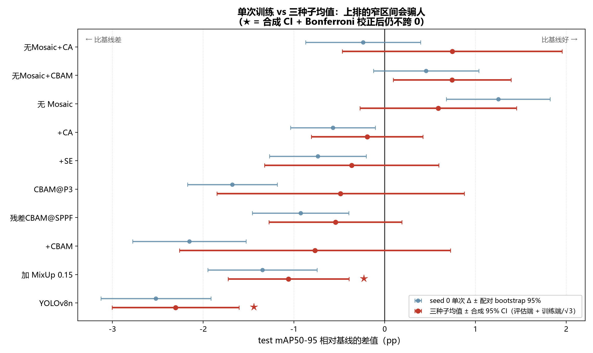

# 无人机航拍甘蓝检测 · 一次可复核的消融复现

复现一篇 YOLOv11n 甘蓝检测论文的四组消融（模型对比 / 数据增强 / 注意力 / 交叉实验），
然后用 **33 次训练（11 组配置 × 3 个种子）+ 配对 bootstrap** 追问一句原论文没问的话：

> **这些结论里，有多少其实是噪声？**

答案：**10 个对比里只有 2 个站得住。**



<sub>上排 = seed 0 单次配对 CI，下排 = 三种子效应量 ± 合成 CI。★ = 能扛住 Bonferroni 校正的，只有 2 个。</sub>

## 结论

| 结论 | 依据 |
|---|---|
| **三种注意力模块都没有可分辨的增益** | SE / CBAM / CA 配对 Δ 为 −0.36 / −0.77 / −0.19pp，各自门槛 1.29 / 1.67 / 0.51pp |
| **YOLOv8n 明确比 YOLOv11n 差 2.30pp** | 全部对比里最硬的一条，σ 被放大 4.3 倍才会翻转 |
| **加 MixUp 0.15 明确有害 1.06pp** | 唯一能确定方向为负的训练策略改动，余量 1.5× |
| **mAP50 在这批数据上已经饱和** | 33 个 run 极差 0.06pp、组内 σ 0.01pp，它无法区分任何两个配置 |
| **单次训练不能用来排序** | CBAM 单次 −2.15pp，三种子 −0.77pp，而它的 σ 是 1.20pp |

原论文「用 mAP50 排序把 CBAM 选为最优模型」这件事，在可复核的 test 协议下复现不出来。

## 判定表（mAP50-95，test 75 张 / 3765 个真实框）

Δ = 同种子下「配置 − 基线」再取 3 次训练平均。全部 σ 均为实测，无借用值。

| 配置 | Δ | 配对 σ | 合成 Bonferroni 95% CI | 判定 |
|---|---|---|---|---|
| YOLOv8n | **−2.30pp** | 0.31pp | [−3.31, −1.30] | **显著为负** |
| 加 MixUp 0.15 | **−1.06pp** | 0.25pp | [−2.01, −0.11] | **显著为负** |
| +CBAM | −0.77pp | 1.20pp | [−2.90, +1.37] | 不可区分 |
| 残差CBAM@SPPF | −0.54pp | 0.45pp | [−1.59, +0.51] | 不可区分 |
| CBAM@P3 | −0.49pp | 1.12pp | [−2.44, +1.46] | 不可区分 |
| +SE | −0.36pp | 0.71pp | [−1.74, +1.01] | 不可区分 |
| +CA | −0.19pp | 0.35pp | [−1.07, +0.69] | 不可区分 |
| 无 Mosaic | +0.59pp | 0.57pp | [−0.64, +1.83] | 不可区分 |
| 无Mosaic+CBAM | +0.74pp | 0.25pp | [−0.18, +1.67] | 不可区分 |
| 无Mosaic+CA | +0.75pp | 0.91pp | [−0.99, +2.48] | 不可区分 |

> **「无Mosaic+CBAM」是多重比较的教科书案例**：不校正时 95% CI 是 [+0.10, +1.39]，不含 0，
> 看起来是个发现；10 重校正后变成 [−0.18, +1.67]，跨过 0。**做了 10 次比较就必须校正 10 次。**

## 数据不公开，但结论可复核

```bash
git clone https://github.com/3086-x/cabbage-detection
cd cabbage-detection && bash reproduce.sh stats
```

**不需要数据集、不需要 GPU、不需要任何模型权重。** 仓库里带了 33 个 run 的训练曲线快照
（`artifacts/results_csv/`，268 KB），σ、MDD 与判定门槛可以原样重算。

已实测：全新克隆后复算出的 `seed_variance.json` 与 `noise_budget.json`，与主仓库**逐字段一致**。

数据为什么不公开、标注是怎么从点扩成框的，见 [DATA.md](DATA.md)。这里要说明的是：
**原始标注是中心点，边界框是按估算直径扩出来的，所以 mAP 的绝对值不宜与其他工作横比；
但 33 个 run 共用同一份标签，配置之间的相对比较完全成立** —— 这也是本仓库把结论建立在
配对差值而非绝对 mAP 上的原因。

## 三层误差棒

| 层 | 做法 | 得到什么 |
|---|---|---|
| 可复现性 | 同 seed 重跑 50 轮 | 指标逐位相同（loss 差 `+0.00e+00`），排除算子非确定性 |
| 训练随机性 | 11 组 × 3 种子 = 33 run | 组内 σ **0.10 ~ 1.16pp**（不是常数，差 11 倍） |
| 评估抽样 | 75 图 × 1000 次**配对** bootstrap | Δ 的 CI 半宽 ±0.57pp（非配对是 ±2.66pp） |

这个误差棒被审过三次，每次都推翻了一个结论：

| 版本 | 判据 | 错在哪 |
|---|---|---|
| v1 | <1.0 / 1.0~2.7 / >2.7pp | 用非配对 CI 当配对门槛，高估 5 倍 |
| v2 | ±1.15 / Bonferroni ±1.64pp | 训练端 σ 只有 2 组实测，其余借用基线值 |
| v3 | 查各配置自己的 MDD，但仅 5 组实测 | 唯一过线的 YOLOv8n 恰好在借用名单里 |
| **v4（当前）** | 11 组全部实测 σ + 双噪声合成 + Bonferroni | — |

其中 v3 的错法最隐蔽：YOLOv8n 当时借用的 σ = 0.74pp，实测只有 0.31pp，高估 2.4 倍，
把余量从 4.3 倍压到 1.1 倍 —— **差一点把最硬的一条结论当成不可靠而丢掉**。
完整沿革见 [REPRO_STATUS.md](REPRO_STATUS.md) 第 11.7 节。

## 为什么值得看

1. **标注不是框，是点。** 自采无人机正射影像，标注为中心点，用「相邻点间距的 10% 分位数
   估株距 × 扩框系数 0.53」自适应扩成边界框。市面数据集没有这个问题，这套转换逻辑不可替代。
2. **评估体系是重做的。** 发现 mAP50 饱和后，补了计数精度（MAE / MAPE / 偏差 / 完全数对率）
   与分密度（sparse / medium / dense）两档，因为农业真正关心的是「数错几株」。
3. **计数阈值本身也是个变量。** 第一版固定 iou=0.7，发现密集场景下相邻植株框 IoU 大量落在
   0.5~0.7，**MAE 实际由阈值决定而非模型决定**。于是改了单次前向 + 网格扫描，val 选参、test 报告。
4. **修正了原论文的一处空实验。** 原论文的「无 MixUp」对照是空实验 —— ultralytics 的
   `mixup` 默认就是 0.0，dump 全部历史 run 的 `args.yaml` 后发现每一个都是 0.0，
   所以「移除 MixUp」与「完整增强」配置完全相同。本工作改成主动加入 `mixup=0.15` 才构成真对照。

## 局限

- **n=3 的 σ 本身不可靠**：σ 的 90% CI 约 [0.58s, 4.4s]，所以判定只到量级，**不报 p 值**。
- **50 epoch 偏少**：注意力层是随机初始化的，残差版的 γ 只学到 ±0.003、接近自我关闭，
  这可能是注意力组 σ 偏大的原因之一。
- **计数改善未做多种子验证**：MAE 3.07 → 2.2~2.8、偏差 −2.27 → ≈0 是 seed 0 单次 + val 选参的结果，
  按本仓库自己的标准不能当结论用。机制上它主要来自**系统性偏差被消除**（不再稳定漏检 2 个），
  而不是定位变准。
- **A 组缺 RT-DETR 的统一协议**：原论文只跑 20 epoch、必须用 AdamW 小学习率、8G 显存下 batch 只能到 4，
  三项协议都不同，需单独设计。现有那行是跨环境历史数据，只作存在性证明、不参与排名。
- **测速是单点测量，没有重复实验**：部署那组每种配置只跑 1 次（预热 25 + 计时 150 取中位），
  不像主实验那样有 3 种子与 bootstrap。所以「1.69×」是测量值，不是区间。同机跨天复跑，
  绝对值会差 25% 以上，只有同一次运行内的比值可信。TensorRT 与 FP16 未测（sm_120 需单独适配 TRT 10.x）。
- **INT8 不划算，已回退 FP32**：量化后 mAP50-95 掉 0.56pp（落在本数据集的可分辨门槛内），
  但前向反而慢 23%（51.93ms vs 42.27ms）——小模型上量化的重排开销超过整数卷积的收益。
  服务端最终用 FP32。详见 [docs/DEPLOY.md](docs/DEPLOY.md)。
- **Docker 镜像未实测构建**：本机没有 Docker，Dockerfile 与 compose 按 CPU-only 最小依赖写好，
  但没有实际构建过，不能当作「已验证可部署」。

## 后续

- **视觉能力服务化 → 已完成**：见 [cabbage-vision-agent](https://github.com/3086-x/cabbage-vision-agent)。
  检测已封装成 5 个按决策点划分的工具（图质量检查 / 检测 / 轻量计数 / 换阈值复核 / 批量），
  输出结构化结果（株数、密度分级、逐框置信度分布）而非一张标注图，让上层编排自己决定
  要不要复查、要不要换阈值重跑。本仓库的结论直接决定了那边的选型：注意力模块无可分辨增益，
  所以工具层固定用 YOLOv11n 基线，复杂度花在编排与错误恢复上，而不是继续堆结构。
- **ONNX 部署链路 → 已完成**：导出后做张量级与框级两级自检，同输入下 PyTorch 与 ONNX 的
  mAP50-95 差 **0.0001**、框坐标偏差 **0.024px**；ORT-CPU 前向比 PyTorch-CPU 快 **1.81×**。
  同一个 GPU 上 ORT 比 PyTorch 快 **1.69×**（7.64 vs 12.90ms），开 CUDA Graph 后 **3.03ms / 4.26×**。
  FastAPI 服务 4 路并发约 **30 QPS / P95 156ms**，与离线评估的株数逐图一致。
  做的过程中撞到三个不报错只掉点的坑（val 输入是 672 不是 640、INT8 全量化把分类分支打塌、
  ORT-GPU 因 CUDA 大版本不匹配静默回落 CPU），过程与负结果都在 [docs/DEPLOY.md](docs/DEPLOY.md)。
- **TensorRT 时延**：须先锁频 + 热稳态才有意义，且 sm_120 要单独适配，未做。
- **按密度自适应计数阈值**：sparse / medium / dense 三档的最优 conf 并不相同，
  现在用 val 选出的单一全局值。

## 文档

| 想了解 | 看 |
|---|---|
| 数据规模、标注口径、为何不公开 | [DATA.md](DATA.md) |
| 环境、8G 显存下的实操约束 | [docs/ENVIRONMENT.md](docs/ENVIRONMENT.md) |
| ONNX 导出、INT8 取舍、服务与压测 | [docs/DEPLOY.md](docs/DEPLOY.md) |
| 注入实现要点、复现命令、目录结构 | [docs/METHOD.md](docs/METHOD.md) |
| 原论文实验矩阵 vs 本次覆盖、判据沿革、作废结论 | [REPRO_STATUS.md](REPRO_STATUS.md) |
| 完整实验记录与踩坑过程 | [EXPERIMENT_CBAM.md](EXPERIMENT_CBAM.md) |
| 四组对比表原始数据 | [eval_reports/compare.md](eval_reports/compare.md) |

代码与文档以 MIT 发布；数据集不在本仓库中，亦不随该许可分发。
