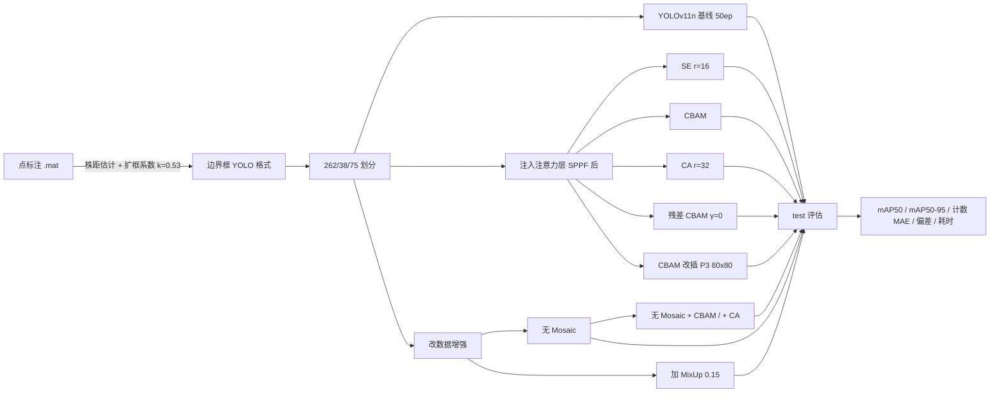

# 方法与实现细节

本文件承接首页移出的实现级内容。结论与判定表见 [README](../README.md)，
实验沿革见 [REPRO_STATUS](../REPRO_STATUS.md) 与 [EXPERIMENT_CBAM](../EXPERIMENT_CBAM.md)。

## 1. 整体流程



## 2. 注意力注入的四个实现要点

`tools/train_cbam_fixed.py` 里踩过四个坑，每一个不处理都会静默产生错误结果：

1. **层间索引会错位**。读官方 `yolo11.yaml`，在目标层后插入一层后，必须把所有
   ≥ 插入点的绝对索引 +1 —— YOLO 每层都有 `f` 来源索引，直接 `nn.Sequential` 拼层会错位。
2. **自定义模块不会被自动缩放通道**。`parse_model` 只对已知模块做通道缩放，自定义模块
   必须自己写缩放后的实际通道数（yolo11n 的 SPPF 输出是 `1024×0.25 = 256`，不是 1024）。
3. **插在 skip-connection 源头时必须改下游引用**。比如插在 P3，后续引用该层的层
   必须改指向注意力层，否则 Detect 仍然取用未经注意力的原始特征 —— 训练能跑完、
   指标也正常，但等于没插。
4. **预训练权重必须重映射并断言**。插入点之后的层号要 +1 后重新对齐加载；并且要断言
   训练器真的保留了这份权重 —— ultralytics 的 `model.train()` 在 `self.ckpt` 为空时会
   **静默丢弃**手工加载的预训练权重，把模型重建为随机初始化。本项目早期就是栽在这里，
   得出过「CBAM 掉 9.7pp」的假结论。

## 3. 复现命令

### 环境

```bash
python -m venv .venv
source .venv/Scripts/activate
pip install -r requirements.txt
pip install torch torchvision --index-url https://download.pytorch.org/whl/cu128
```

详见 [ENVIRONMENT.md](ENVIRONMENT.md)。

### 训练全部 33 个 run

```bash
bash reproduce.sh train
```

内部等价于（单 run 示例）：

```bash
# 基线
python tools/train_baseline.py --epochs 50 --batch 8 --device 0 --workers 0 --name train_base_v2

# 三种注意力模块（复现 C 组）
python tools/train_cbam_fixed.py --variant se --epochs 50 --batch 8 --device 0 --workers 0 --name train_se
python tools/train_cbam_fixed.py --epochs 50 --batch 8 --device 0 --workers 0 --name train_cbam_v2
python tools/train_cbam_fixed.py --variant ca --epochs 50 --batch 8 --device 0 --workers 0 --name train_ca

# 注入形式扩展（原论文没有，本工作新增 E 组）
python tools/train_cbam_fixed.py --variant residual --epochs 50 --batch 8 --device 0 --workers 0 --name train_cbam_res_v2
python tools/train_cbam_fixed.py --insert-index 16 --epochs 50 --batch 8 --device 0 --workers 0 --name train_cbam_p3

# 增强消融与交叉实验（B / D 组）
python tools/train_baseline.py   --mosaic 0.0 --epochs 50 --batch 8 --device 0 --workers 0 --name train_base_nomosaic
python tools/train_baseline.py   --mixup 0.15 --epochs 50 --batch 8 --device 0 --workers 0 --name train_base_mixup
python tools/train_cbam_fixed.py --mosaic 0.0 --epochs 50 --batch 8 --device 0 --workers 0 --name train_cbam_nomosaic
python tools/train_cbam_fixed.py --variant ca --mosaic 0.0 --epochs 50 --batch 8 --device 0 --workers 0 --name train_ca_nomosaic

# YOLOv8n（A 组）
python tools/train_baseline.py --model yolov8n.pt --epochs 50 --batch 8 --device 0 --workers 0 --name train_yolov8n
```

单次 50 epoch 在 RTX 5060 上约 8~13 分钟。`--workers 0` 是有意为之：
16G 内存机器上 `workers>=4` 会因数据加载进程 OOM。

### 评估与统计

```bash
bash reproduce.sh eval    # 逐 run 评估 test
bash reproduce.sh stats   # 三层统计，无需数据与 GPU
```

`count_sweep.py` 与 `bench_speed.py` 必须**一次给全 11 组**，否则各组阈值/批次不同、结果不可比：

```bash
python tools/count_sweep.py --models base_v2:<path> se:<path> cbam_v2:<path> ...
python tools/bench_speed.py --models base_v2:<path> se:<path> cbam_v2:<path> ...   # 测速须独占 GPU
```

## 4. 目录说明

```
├── tools/                       复现脚本（19 个）
│   ├── cbam_module.py           CBAM / CBAMResidual，注册进 ultralytics 命名空间
│   ├── attention_modules.py     SE / CoordAtt（8.4.194 已移除，按原实现重写）
│   ├── train_cbam_fixed.py      注入 yaml 生成 / 预训练重映射 / 权重断言 / 训练
│   ├── train_baseline.py        同环境基线
│   ├── eval_full.py             检测 + 计数 + 分密度评估
│   ├── count_sweep.py           (conf, iou) 网格扫描，val 选参 test 报告
│   ├── bench_speed.py           参数量与 fused 耗时
│   ├── make_report.py           汇总表与图
│   ├── bootstrap_ci.py          单模型 bootstrap（非配对，不能当比较门槛）
│   ├── paired_bootstrap.py      配对 bootstrap：Δ 的 CI + Bonferroni
│   ├── seed_variance.py         种子方差、配对 Δ、MDD
│   ├── noise_budget.py          评估端 + 训练端噪声合成，输出最终判定
│   ├── experiment_registry.py   11 组 ↔ 33 run 的唯一映射来源
│   ├── check_pairing.py         校验种子 run 与原 run 只差 seed（114 字段 + 结构签名）
│   ├── train_seeds.sh           可重入种子训练驱动（跳过已完成、崩溃重试一次）
│   ├── eval_seeds.sh            可重入种子评估驱动
│   └── probe_pretrained.py      诊断：训练前 mAP 是否等于基线
├── cfg/                         5 份模型结构配置
├── eval_reports/                逐 run 指标、四组对比表、三层统计结果与图
├── artifacts/results_csv/       33 份训练曲线快照（离线复算用，268 KB）
├── docs/                        环境与方法细节
├── data.yaml                    数据集索引（相对路径）
├── reproduce.sh                 分阶段复现入口
├── REPRO_STATUS.md              原论文实验矩阵 vs 本次覆盖，含判据沿革
├── EXPERIMENT_CBAM.md           完整实验记录与踩坑过程
└── DATA.md                      数据规模、标注口径、为何不公开
```
